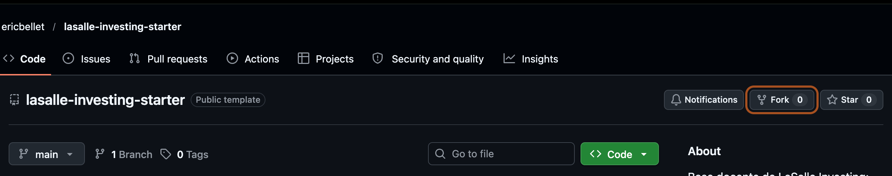

# LaSalle Investing · repositorio de partida

> **Alumno ficticio: Pepito Gonzales.** Esta copia sirve para probar el recorrido de la guía y la integración con el leaderboard. Se ha generado desde la plantilla en la cuenta del profesor; no es un fork entre dos cuentas de GitHub. El alumnado debe seguir el procedimiento de fork explicado abajo desde su propia cuenta.

Base común de los proyectos del curso: **datos ya descargados, ETL de referencia, selección Top 3 y API funcional**. Se mantiene el mismo código de selección inicial para todos. Cambiar la estrategia es opcional.

La plataforma del campeonato la mantiene el profesor. Quien quiera colaborar puede proponer mejoras mediante issues y pull requests en [el repositorio de la plataforma](https://github.com/ericbellet/proyecto_lasalle_2026_2027). Esa colaboración es voluntaria.

## 1. Crea tu repositorio en GitHub

Un **fork** es tu copia del proyecto del profesor dentro de GitHub. Primero creas esa copia en tu cuenta y después la descargas al ordenador con `git clone`.

### A. Hacer el fork en tu cuenta

1. Abre [GitHub](https://github.com) e inicia sesión con **Sign in**. Si todavía no tienes una cuenta personal, créala antes de continuar.
2. Abre [ericbellet/lasalle-investing-starter](https://github.com/ericbellet/lasalle-investing-starter). Comprueba el propietario y el nombre para asegurarte de que estás en la base del alumnado.
3. Busca **Fork** arriba a la derecha, junto a las notificaciones y las estrellas. Pulsa el botón. Si aparece un menú, elige **Create a new fork**.



4. En el formulario, elige estos valores:

| Campo | Qué debes poner |
|---|---|
| **Owner** | Tu usuario personal de GitHub |
| **Repository name** | `lasalle-investing-starter`; conserva el nombre para seguir los comandos del curso |
| **Description** | Opcional; puedes mantener la que aparece |
| **Copy the main branch only** | Mantén la casilla marcada para copiar la rama de trabajo inicial |

5. Pulsa el botón verde **Create fork**, al final del formulario. Espera a que GitHub abra tu nuevo repositorio.
6. Comprueba que el propietario que aparece arriba es **tu usuario**. Debajo del nombre verás **forked from ericbellet/lasalle-investing-starter**: esa referencia confirma el origen de la copia.

**Resultado:** ya tienes tu repositorio en GitHub. Todavía no has descargado sus archivos al ordenador. Si GitHub indica que ya tienes un fork, abre esa copia desde tu cuenta y continúa con el apartado B.

### B. Descargar tu fork al ordenador

1. Entra en tu fork y pulsa **Code → Local → HTTPS**.
2. Copia la URL completa con el botón de copiar. Comprueba que el propietario de la URL es tu usuario.
3. Abre una terminal en la carpeta donde quieras guardar el trabajo. Escribe `git clone`, deja un espacio, pega la URL copiada y pulsa Intro. No escribas literalmente `TU_USUARIO`.
4. Espera a que termine la descarga. Aparecerá la carpeta `lasalle-investing-starter`.
5. Entra en ella y comprueba la conexión con GitHub:

```bash
cd lasalle-investing-starter
git remote -v
```

Las líneas de `origin` deben apuntar a tu fork, con tu usuario como propietario. Al terminar debes tener **el fork en GitHub y la carpeta del proyecto en tu ordenador**.

### C. Instalar las dependencias

Desde esa misma carpeta, ejecuta:

```bash
uv sync --locked --python 3.11
```

Referencia: [documentación oficial de GitHub sobre forks](https://docs.github.com/en/pull-requests/how-tos/work-with-forks/fork-a-repo).

## 2. Arranca la API con los datos incluidos

```bash
uv run uvicorn app:app --reload
```

Abre [las selecciones](http://127.0.0.1:8000/api/predictions), [el estado](http://127.0.0.1:8000/api/health) o [Swagger](http://127.0.0.1:8000/docs). La respuesta inicial ya contiene nueve selecciones: tres de `1W`, tres de `1M` y tres de `3M`. El nombre inicial es un ejemplo.

## 3. Configura tu nombre, acciones y fondos

Edita `config.toml`: escribe el nombre con el que te ha registrado el profesor y tu lista de tickers. **Puedes elegir acciones de cualquier país, fondos de inversión y ETF.** El snapshot inicial no limita tu universo. Comprueba el identificador, moneda e histórico de cada instrumento y que la plataforma pueda recuperar su cotización o valor liquidativo al resolver las selecciones. Necesitas al menos tres instrumentos distintos con datos suficientes.

Con el universo inicial puedes publicar de inmediato:

```bash
uv run python publish.py
```

Recarga `/api/predictions`: debe aparecer tu nombre. Dos consultas conservan la misma fecha y resultado. Para detener el servidor utiliza `Ctrl+C`.

Si añades una acción sin datos, el publicador lo indica y conserva la última salida correcta. Descargar nuevas acciones requiere actualizar la entrada como explica el apartado 7.

## 4. Localiza los datos raw y el Data Lake

**Raw es la respuesta original del proveedor, guardada antes de limpiar o transformar.** En esta base está en `lake/raw/yahoo/<descarga>/`. Cada JSON contiene la respuesta literal de una empresa; `manifest.json` guarda URL, fecha de descarga y huella SHA-256.

```text
lake/
  raw/yahoo/<descarga>/<TICKER>.json
  raw/yahoo/<descarga>/manifest.json
  clean/prices.csv
  curated/features.csv
artifacts/predictions.json
reports/quality.json
reports/selection.json
```

El snapshot incluido contiene **1.420 cierres diarios reales de diez empresas, del 1 de abril al 22 de octubre de 2026**. Su procedencia está en [DATOS.md](DATOS.md). Es una copia fija: no se actualiza por consultar la API. Comprueba su fecha antes de utilizarla en un ciclo nuevo.

No cambies los originales para arreglar datos. Corrige la transformación y escribe en clean o curated. Una nueva descarga crea otra carpeta raw. El cargador comprueba las huellas para detectar cambios accidentales.

## 5. Ejecuta el ETL con PySpark

Necesitas Docker en funcionamiento. Desde la raíz de tu copia:

```bash
docker compose run --rm etl
uv run python publish.py
```

La primera ejecución descarga la imagen de Spark. El contenedor procesa los originales incluidos, guarda Parquet en `lake/clean/prices/` y `lake/curated/features/`, relee los precios y actualiza el informe de calidad. También exporta `lake/curated/features.csv`, que utiliza el publicador.

Inspecciona `reports/quality.json`: el snapshot inicial debe producir 1.420 precios, diez empresas y la misma cantidad al releer Parquet. Los ficheros Parquet generados están excluidos de Git; conserva evidencias y las instrucciones para reproducirlos.

El fichero `prepare.py` es el preparador Python del snapshot de referencia. RA1 trabaja con `etl_spark.py`; no basta con ejecutar únicamente el preparador.

## 6. Mantén la selección común o cámbiala

`strategy.py` contiene la función común `score(row, horizon)`. Puedes dejarla como viene. El resto del trabajo se centra en datos, calidad, organización y reproducción.

Si quieres otro criterio para el Top 3, modifica esa función, documenta el cambio y ejecuta `uv run python publish.py`. El publicador aplica la regla al universo configurado y toma las tres primeras acciones de cada horizonte. No cambies el contrato HTTP.

Los candidatos completos se guardan en `reports/selection.json`. Un score ordena empresas y no debe presentarse como una probabilidad.

## 7. Actualizar o ampliar datos

El arranque no necesita ninguna descarga. Para actualizar la muestra con el adaptador incluido, configura primero los tickers y elige un rango con al menos 61 sesiones válidas por empresa:

```bash
uv run python download.py --start 2026-04-01 --end 2026-10-22
docker compose run --rm etl
uv run python publish.py
```

Adapta las fechas al periodo que necesites. Este adaptador utiliza un acceso web de Yahoo Finance que puede cambiar; no es una API oficial garantizada. Investiga otras fuentes y sustituye el adaptador si ofrecen mejor cobertura, histórico, documentación o condiciones para tu caso. Conserva siempre las respuestas raw y su procedencia.

## 8. Opciones de almacenamiento

**Puedes completar todos los requisitos obligatorios de RA1 con los ficheros en local. Se concederán puntos extra si guardas los datos en AWS S3, Azure Data Lake o un servicio similar** y demuestras escritura, lectura desde el ETL y recuperación. También puedes investigar Cloudflare R2 y Supabase Storage. Distingue cuota gratuita mensual de créditos temporales o de estudiante y revisa las condiciones de tu cuenta.

Un bucket es un contenedor de ficheros. Puedes conservar prefijos `raw/`, `clean/` y `curated/`. Supabase Storage guarda ficheros; las tablas PostgreSQL corresponden al warehouse de RA2. No subas credenciales a GitHub.

## 9. Comprueba y publica

```bash
uv run pytest -q
```

El repositorio incluye comprobaciones de universo configurable, fallos que conservan el artefacto, integridad raw y estabilidad de la API. GitHub Actions ejecuta las pruebas al subir cambios.

Para construir una imagen de la API, después de publicar tu nombre y resultado:

```bash
docker build -t mi-api-inversion .
docker run --rm -p 8000:8000 mi-api-inversion
```

Elige un alojamiento que sirva esa API por HTTPS y conserva el artefacto después de reiniciar. No se incluye un despliegue automático ni se contrata un servicio. La URL pública debe devolver directamente el JSON, sin login ni una página HTML. Entrega al profesor tu nombre y la URL completa de `/api/predictions`.

## Continuidad de los RA

- **RA1:** inspeccionar y adaptar el ETL, justificar el lake, aplicar calidad e investigar fuentes. La selección común ya está resuelta; cambiarla es opcional.
- **RA2:** cargar el warehouse, entrenar y evaluar ML frente a la versión `v1` que hayas conservado.
- **RA3:** añadir herramientas y agentes, evaluar frente a `v2` y conservar el contrato de la API.
